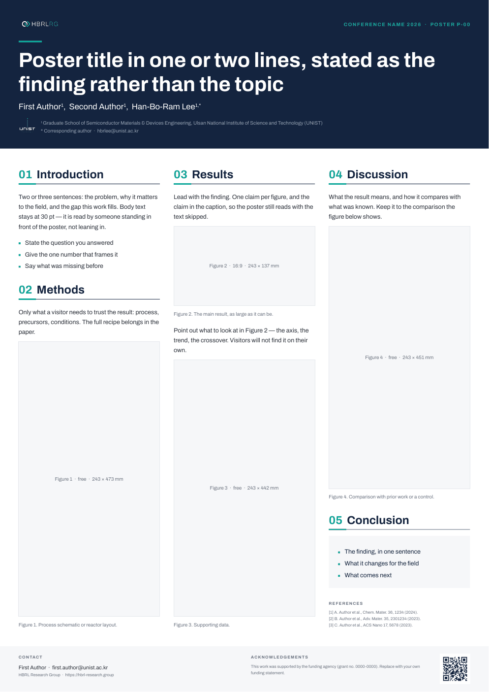

# Conference poster template · 학회 포스터 템플릿

For poster sessions. A0 portrait, three columns, in PowerPoint so that co-authors
and print shops can both open it.

학회 포스터 발표용입니다. A0 세로, 3단 구성이고, 공동 저자와 인쇄소가 모두 열 수
있도록 파워포인트 파일로 둡니다.

**Get the PPTX · PPTX 받기** → [Releases](../../../releases/latest) → `hbrlrg-poster-a0-portrait.pptx`
**Sample · 샘플** → [`sample/hbrlrg-poster-a0-portrait.pdf`](sample/hbrlrg-poster-a0-portrait.pdf)



> **Draft · 초안.** This first version follows the design system alone. The
> layout will be revised, and landscape / A1 variants added, once the reference
> posters the group actually uses arrive in [`references/posters/`](../references/posters/).
>
> 이 판은 디자인 시스템만을 기준으로 한 초안입니다. 연구실이 실제로 쓰는 포스터
> 형식이 [`references/posters/`](../references/posters/) 에 들어오면 그에 맞춰 레이아웃을
> 고치고 가로형 · A1 같은 변형판을 더합니다.

---

## The grid · 격자

| | A0 portrait · A0 세로 |
| --- | --- |
| Page · 판형 | 841 × 1189 mm |
| Margin · 여백 | 32 mm |
| Columns · 단 | 3 × 243 mm, gutter 24 mm · 단 간격 24 mm |
| Header · 머리 | Navy, 255 mm · 네이비, 255 mm |
| Footer · 꼬리 | Surface grey, 78 mm · 회색, 78 mm |
| Figure width · 그림 폭 | **243 mm** — one column · 한 단 |

Every column ends on the same line. In the template, one figure per column takes
up whatever height the text leaves, which is what lines the three columns up at
the bottom. The label inside each figure well gives its size in mm, so the image
can be made to fit before it is pasted in.

세 단의 끝선이 모두 같습니다. 템플릿에서는 단마다 그림 하나가 글이 남긴 높이를
모두 차지하도록 해서 세 단의 아래 끝을 맞췄습니다. 그림 자리 안의 글자가 그 자리의
크기(mm)를 알려 주므로, 그림을 그 비율로 만들어 붙이면 됩니다.

## Type · 글자 크기

A poster is read from two distances: across an aisle (about 5 m), and standing
in front of it (about 1.5 m). The sizes follow from those two distances.

포스터는 두 거리에서 읽힙니다 — 통로 건너편(약 5 m)과 바로 앞(약 1.5 m). 크기는
이 두 거리에서 정해졌습니다.

| Role · 역할 | Size · 크기 | |
| --- | --- | --- |
| Title · 제목 | 100 pt, bold, white | Read from the aisle · 통로에서 읽힘 |
| Section heading · 섹션 제목 | 56 pt, bold, navy, teal number | |
| Authors · 저자 | 40 pt | |
| **Body · 본문** | **30 pt** | **The floor, not a target · 최소값이지 목표가 아님** |
| Caption · 그림 설명 | 24 pt, muted | |
| Affiliation · 소속 | 24 pt | |
| References, footer · 참고문헌, 꼬리 | 20 pt | **Nothing goes smaller · 이보다 작게 쓰지 않음** |

If the text does not fit at 30 pt, **cut the text**, not the size.

본문이 30 pt 로 들어가지 않으면 크기가 아니라 **글을 줄이세요**.

## Editing in PowerPoint · 파워포인트에서 고치기

1. **Header · 머리** — conference name and poster number (top right), title,
   authors, affiliation. Mark the presenting author however the conference asks.<br>
   학회명 · 포스터 번호(우상단), 제목, 저자, 소속을 바꿉니다. 발표자 표시는 학회 요구대로.
2. **Title · 제목** — state the finding, not the topic. One or two lines; a third
   line still fits, but the header grows.<br>
   주제가 아니라 결론을 제목으로 쓰세요. 한두 줄. 세 줄도 들어가지만 머리가 커집니다.
3. **Figures · 그림** — insert the image, set its **width to 243 mm** (Format
   Picture → Size), place its top-left corner on the grey well, then delete the
   well. Do not stretch: let the height follow.<br>
   그림을 넣고 **폭을 243 mm** 로 맞춘 다음(그림 서식 → 크기), 왼쪽 위 모서리를 회색
   자리에 맞추고 회색 자리는 지웁니다. 늘리지 말고 높이는 비율대로 두세요.
4. **Sections · 섹션** — the five sections are a starting point. Rename them, or
   merge Discussion into Results. Keep the numbered heading with its rule.<br>
   다섯 섹션은 출발점입니다. 이름을 바꾸거나 Discussion 을 Results 에 합쳐도 됩니다.
   번호 붙은 제목과 그 아래 선은 유지하세요.
5. **Footer · 꼬리** — your contact email and the funding statement. The QR code
   goes to the group homepage; replace it with your paper's DOI if you have one,
   and keep it at least 30 mm wide so it scans from a step away.<br>
   연락처와 사사 문구를 바꿉니다. QR 은 연구실 홈페이지로 연결됩니다. 논문 DOI 가
   있다면 그걸로 바꿔도 되고, 한 걸음 떨어져서도 찍히도록 폭 30 mm 이상을 유지하세요.

**PowerPoint does not re-flow the columns.** When a text block grows, move the
blocks below it down by hand and shorten that column's large figure so the
column still ends on the common line (y = 1079 mm).

**파워포인트는 단을 다시 배치해 주지 않습니다.** 글 상자가 길어지면 그 아래 요소를
직접 내리고, 그 단의 큰 그림 높이를 줄여 단 끝이 공통선(y = 1079 mm)에 맞도록
하세요.

### Leave alone · 건드리지 않을 것

- Colours: navy header, teal accent only, no other colours for decoration.<br>
  색: 네이비 머리, 강조는 청록 하나. 장식용으로 다른 색을 더하지 않습니다.
- The HBRLRG logo top left, and the UNIST emblem next to the affiliation. The
  emblem never stands alone (design system §8).<br>
  좌상단 HBRLRG 로고, 소속 옆 UNIST 엠블럼. 엠블럼은 소속 문구 없이 쓰지 않습니다(규격 §8).
- Fonts: Archivo and Pretendard are embedded in the file. Do not substitute.<br>
  서체: Archivo · Pretendard 가 파일에 들어 있습니다. 다른 서체로 바꾸지 마세요.

## Printing · 인쇄

Export a PDF from PowerPoint (File → Export → PDF) and send the PDF, not the
PPTX. Print at 100 %, A0. Embedded fonts are read only by Microsoft PowerPoint;
open the PPTX anywhere else and Korean in particular may fall back to another
typeface, so check the PDF before sending it.

파워포인트에서 PDF 로 내보내(파일 → 내보내기 → PDF) PPTX 가 아니라 PDF 를
인쇄소에 보내세요. A0, 100 % 로 출력합니다. 임베드된 서체를 읽는 것은 마이크로소프트
파워포인트뿐이라, 다른 프로그램에서 열면 특히 한글이 다른 서체로 바뀔 수 있습니다.
보내기 전에 PDF 를 확인하세요.

Photos and plots: at A0, 150 ppi at final size is enough. A 243 mm wide figure
is about 1440 px.

사진과 그래프는 최종 크기에서 150 ppi 면 충분합니다. 폭 243 mm 그림이면 약
1440 px 입니다.

---

## Rebuilding · 다시 만들기

The PPTX is generated, not hand-made, and each release rebuilds it.

PPTX 는 손으로 만든 것이 아니라 생성한 것이고, 릴리스마다 새로 만듭니다.

```bash
python3 tools/build_poster.py office --fonts .fonts            # A0 portrait
python3 tools/build_poster.py office --format a0-portrait      # same; formats: see FORMATS
```

The script measures every text block against Archivo's real glyph widths, so it
needs `Archivo-Regular.ttf` and `Archivo-Bold.ttf` — the same files the release
workflow fetches into `.fonts/`. It stops with a message if a column has too
much text to leave a usable figure (under 100 mm).

스크립트는 글 상자마다 Archivo 의 실제 글자 폭으로 줄 수를 재기 때문에
`Archivo-Regular.ttf` · `Archivo-Bold.ttf` 가 필요합니다(릴리스 워크플로가 `.fonts/` 에
받는 것과 같은 파일). 한 단에 글이 너무 많아 그림 자리가 100 mm 아래로 줄면 멈추고
알려 줍니다.

A new size or orientation is one entry in `FORMATS` in `tools/build_poster.py`.

새 판형이나 방향은 `tools/build_poster.py` 의 `FORMATS` 에 항목 하나를 더하는 일입니다.
