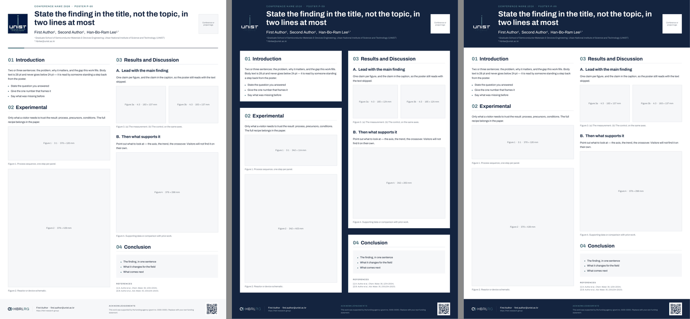

# HBRLRG conference poster templates

PowerPoint templates for poster sessions, in three styles and two sizes. Each
one is a single editable slide with the fonts embedded.

**Download** → [latest release](../../../releases/latest) → `hbrlrg-poster-<size>-<style>.pptx`
**Samples** → [`sample/`](sample/) (one PDF per template)



---

## Pick a file

| | `standard` | `panel` | `band` |
| --- | --- | --- | --- |
| Look | White page, navy-and-teal rule under the header | Navy page, each section on a white panel | Navy header and footer bands, white body |
| Good for | Conference sessions (the default) | Project reports and workshops | Exhibitions, lab showcases |

| Size | Files | Use it when |
| --- | --- | --- |
| **A0** · 841 × 1189 mm | `hbrlrg-poster-a0-*.pptx` | The conference says A0, or says nothing |
| **KCS** · 900 × 1200 mm | `hbrlrg-poster-kcs-*.pptx` | KCS (Korean Conference on Semiconductors) and others that ask for 90 × 120 cm |

**Check the conference's poster size before you start.** If it is neither of
these, ask for one: a new size is a one-line change in the generator. Don't resize
a slide in PowerPoint. Scaling the page also scales every font, and the type
sizes below stop being true.

## What is on the page

```
┌────────────────────────────────────────────────────┐
│ [UNIST]  CONFERENCE NAME 2026 · POSTER P-00  [logo] │  header, 12–16 % of the height
│ emblem   Title, two lines at most            slot  │
│          Authors · affiliation                     │
├─────────────────────────┬──────────────────────────┤
│ 01 Introduction         │ 03 Results and Discussion │
│ 02 Experimental         │    A. …   B. …           │  two equal columns, 24 mm apart
│    Figure 1 (3:1 strip) │    Figure 3a | 3b        │
│    Figure 2             │    Figure 4              │
│                         │ 04 Conclusion            │
│                         │    References            │
├─────────────────────────┴──────────────────────────┤
│ HBRLRG logo · contact     Acknowledgements      QR │  footer
└────────────────────────────────────────────────────┘
```

- **Left logo**: the UNIST emblem. Leave it where it is. It always appears next to
  the affiliation.
- **Right logo slot**: put the conference's or the funding project's logo here,
  or delete the box if there is none.
- **QR code**: goes to the group homepage. Replace it with your paper's DOI if
  you have one. Keep it at least 30 mm wide so it scans from a step away.

## Type sizes

| Role | Size | Minimum |
| --- | --- | --- |
| Title | 80 pt bold | |
| Section heading (`01 Introduction`) | 52 pt bold | |
| Subsection (`A. …`), authors | 40 pt | |
| **Body text, bullets** | **28 pt** | **24 pt** |
| Figure captions | 24 pt | **20 pt** |
| Affiliation | 24 pt | 20 pt |
| References, footer | 20 pt | 20 pt |

A poster is read from a step or two away. If your text does not fit at 28 pt,
**cut text**. Don't shrink the font. Never go below the minimums. This also
applies to the labels and tick numbers *inside* your figures. A plot exported
for a paper usually has 8 pt axis labels, which become unreadable on a poster.
Re-export it with larger fonts.

## Filling it in

1. **Header.** Replace the conference name and poster number, the title, the
   authors and the affiliation. The title states your result, not your topic:
   *"X halves Y at 200 °C"* rather than *"A study of X."*
   Two lines at most.
2. **Sections.** Replace the instruction text in each box. You can rename the
   sections or merge Results and Discussion. Keep the `01 · 02 · …` numbering.
3. **Figures.** Each grey box is a figure slot, and its label gives the size in mm.
   - Insert your image, then set its **width** to the slot width (*Format
     Picture → Size*) and let the height follow. Never stretch it.
   - Line up the image's top-left corner with the slot, then delete the grey box.
   - Make figures at **150 ppi or more at final size**. A full-column figure
     (378 mm at A0) is then about 2200 px wide.
4. **Conclusion.** Three bullets, one sentence each.
5. **Footer.** Your email, and the funding statement your supervisor gives you.

### When your content is a different length

PowerPoint will not re-flow the columns for you. When a text box grows, move
everything below it down. Then make the last big figure in that column shorter,
so that both columns still end on the same line.

### Leave these alone

- **Colours.** Navy `#14243F` and teal `#0EA79A` only. Don't add other colours
  for decoration. (Your data plots can use whatever colours they need.)
- **Fonts.** Archivo for English, Pretendard for Korean. Both are built into the
  file, so don't change them.
- **Logos.** Don't recolour, stretch or move the UNIST emblem or the HBRLRG
  logo. On a navy background, any other logo goes in a white box.
- **Corners.** Square, no shadows, no gradients.

## Printing

1. Export a PDF from PowerPoint: *File → Export → PDF*. On a Mac, use *File →
   Export*, not *Print → Save as PDF*.
2. Open the PDF and check it at 100 % zoom, especially Korean text and figure
   labels.
3. Send the **PDF** to the print shop, not the PPTX. Ask for the poster size at
   100 %, with no "fit to page."

The embedded fonts only work in Microsoft PowerPoint. If you open the PPTX in
Keynote, Google Slides or LibreOffice, Korean text may change typeface. Edit in
PowerPoint, or check the exported PDF carefully.

---

## For maintainers

The templates are generated by `tools/build_poster.py` and rebuilt on every
release. Don't edit the PPTX files by hand.

```bash
python3 tools/build_poster.py office --fonts .fonts            # all six
python3 tools/build_poster.py office --size kcs --style panel  # one
```

The script word-wraps every text box against Archivo's real glyph widths, so it
needs `Archivo-Regular.ttf` and `Archivo-Bold.ttf`, the files the release
workflow fetches into `.fonts/`. It stops if a header would exceed 16 % of the
page, or if a column holds too much text to leave a figure of at least 100 mm.

A new size is one entry in `SIZES`. The layout decisions and their sources are
in [`references/posters/README.md`](../references/posters/README.md).
